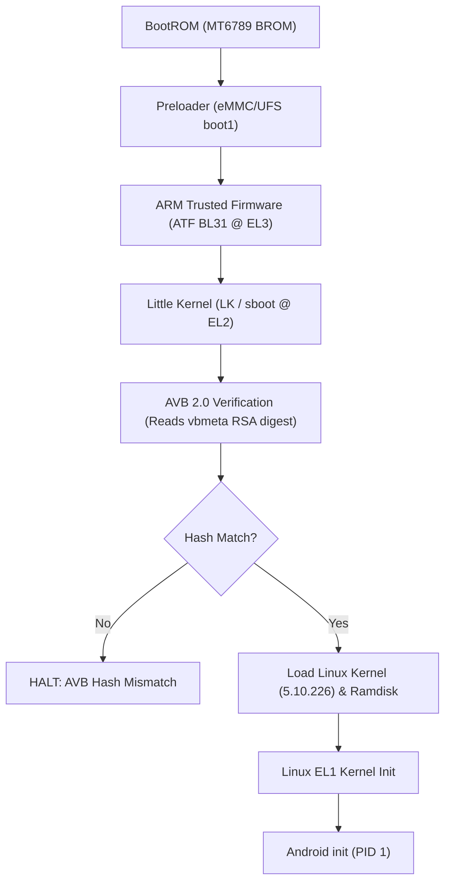
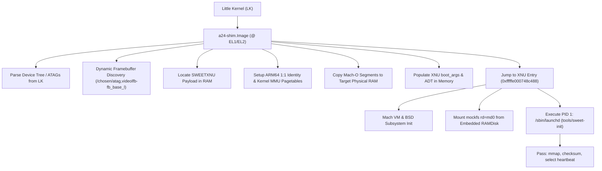

# Preflight Audit & Hardware Deployment Analysis: Apple XNU on Samsung Galaxy A24 (SM-A245F)

## 1. Executive Summary

- **Device**: Samsung Galaxy A24 (`SM-A245F`), MediaTek MT6789 (Helio G99).
- **Current Physical State**: Connected via USB, in **Download Mode** (`ODIN MODE`).
- **Safety Directive**: **STRICT AUDIT & COMPILATION ONLY**. No flashing operations, no partition writes, no automated Odin/Heimdall commands. The device hardware state remains completely untouched.
- **Repository Branch**: `a24-port` (clean working tree).

This document serves as the formal preflight audit, cataloging all compiled artifacts, static verification results, Samsung Secure Boot limitations, and prerequisites required before any physical boot attempt can take place.

---

## 2. Inventory of Target Artifacts

All built target artifacts are located in `artifacts-a24/flash-preflight/`:

| Artifact | Size (Bytes) | Format | Entry / Load Address | SHA-256 | Purpose & Description |
|---|---|---|---|---|---|
| `kernel.development.a24` | 17,153,800 | Mach-O 64-bit arm64 | Entry: `0xfffffe000748c488` VA: `0xfffffe0006000000` | `5767afdfcf8c7b7b84a42b0150d3846343237089ee86a5c20956e4ead2d3ca25` | Target Apple XNU kernel compiled for MT6789 platform. Built with `sweet_hfs`, `mockfs`, ARM GICv3, and MTK UFSHCI support. |
| `out-a24.adt` | 9,412 | Apple Device Tree | Target Type: `D22AP` DRAM Base: `0x100000000` | `622ab0cf784563b1d662fc05314e0056d30634972cc495976d2e22a7c499da69` | Hardware device tree configuring 13 MHz timebase (`A24_TIMEBASE`), 8 cores, 2.33 GiB kernel RAM, GICv3, and buttons. |
| `a24-shim.elf` | 25,912 | ELF 64-bit aarch64 | Entry: `0x00000000` Relocations: 0 | `c8f4ca8c87608d117154e8de57a2f74c87ba0f47898c2834a89560cefc742ae2` | Unstripped freestanding bootstrap shim bootloader. |
| `a24-shim.Image` | 253,952 | Linux ARM64 Image | Header: `0x644d5241` (`ARMd`) Flags: `0xa` | `48d973a8251d212bef1e7cf4275a9aaf7757d6c2234ad1c757b6af9dcfc6ad20` | Flat binary kernel image with Linux ARM64 header for Little Kernel execution. Contains dynamic framebuffer locator. |
| `init` | 16,635 | Mach-O static arm64 | Entry: `0x100000400` Ad-hoc signed | `2733a87bfbfcb3bd9a365398b188910c0f4ce71f3b2531d66f6b4fa20cc109e0` | Static PID 1 userspace entry. Tests console, mmap (16K anon page), memory boundaries, checksum, and runs select heartbeat loop. |
| `a24-payload.bin` | 16,591,136 | SWEETXNU Container | Magic: `SWEETXNU` Ramdisk: `0x1024bc000` | `0b8554cb9e052855ac2777c5e14676e848cf0299eddafbfe88a35aa95a12a9a1` | Combined payload containing rebased XNU kernel segments, hardware ADT, embedded `init` ramdisk, and boot arguments. |
| `a24-xnu-boot.img` | 16,850,944 | Android Boot v4 | Magic: `ANDROID!` Version: 4, 4096-pg | `450e334d8f70525d82cff7cbff0ecf3342059cb7124a5c31c161b9b3e945e342` | Offline packaging of `a24-shim.Image` (kernel) and `a24-payload.bin` (ramdisk) according to AOSP Boot Image Header v4. |
| `stock_boot.img` | 67,108,864 | Samsung Stock Boot | Kernel: `18,737,157` Magic: `SEANDROIDENFORCE` | `9ac63e6a612763a3190d7f2d23031fc311eefca22bd91d3e7feef5fa4e222e84` | Official Samsung factory boot partition dump. Preserved as guaranteed recovery reference. |

---

## 3. Analysis of Previous Bootloader & Odin Failures

During previous flashing attempts, three specific errors were encountered:

### 1. `SECURE CHECK FAIL: (vbmeta)`
- **Mechanism**: The Samsung Download Mode bootloader (`sboot` / MTK Download Agent) intercepts TAR packages before writing them to the flash partitions.
- **Root Cause**: `vbmeta.img` on Samsung Knox devices is signed with a private RSA key belonging to Samsung Electronics. When generating an AVB-disabled image via `avbtool make_vbmeta_image --flags 3`, the generated image is unsigned (or signed with an untrusted test key). Download Mode verifies the image signature against the hardware root of trust (stored in eFuse / RPMB) and immediately rejects it with `SECURE CHECK FAIL: (vbmeta)`.

### 2. `SECURE CHECK FAIL: (boot)`
- **Mechanism**: Occurs when Odin attempts to flash a custom `boot.img` directly to the `boot` partition while the phone's Download Mode bootloader enforces Samsung signature headers.
- **Root Cause**: Samsung firmware uses specialized packaging rules. If the archive structure does not conform to the expected format, or if Knox Guard rejects the unsigned kernel binary during the Odin handshake, Download Mode aborts the session.

### 3. `AVB hash mismatch (init_boot / boot)`
- **Mechanism**: Occurs at boot time in Little Kernel (LK) after Odin successfully passes a file or when partitions are modified.
- **Root Cause**: Stock `vbmeta` contains a cryptographically signed descriptor table holding the expected SHA-256 digests of `boot`, `init_boot`, `vendor_boot`, and `dtbo`. When LK executes in early boot:
  1. It reads the descriptors in `vbmeta`.
  2. It computes the SHA-256 of the flashed partition on flash storage.
  3. Because the kernel was replaced with custom code, the computed hash does not match the signed digest in `vbmeta`.
  4. LK halts with `Hash of data does not match digest in descriptor` and refuses to jump to the kernel.

> [!IMPORTANT]
> Setting `OEM LOCK: OFF (U)` and `WARRANTY VOID: 0x1` disables warranty flags, but does **NOT** grant Download Mode the ability to accept raw, unsigned `vbmeta` images. The Download Mode agent still enforces OEM signature checks.

---

## 4. Boot Architecture Comparison

### A. Samsung Stock Boot Flow

### B. XNU Shim Boot Flow

---

## 5. Hardware vs QEMU Divergence Analysis

| Parameter | QEMU virt-8.2 Model | Physical MT6789 Hardware | Resolution in Codebase |
|---|---|---|---|
| **Timer Frequency** | 62.5 MHz (`CNTFRQ`) | **13.0 MHz** (`0xc65d40` / `clk13m`) | `A24_TIMEBASE = 13000000` hardcoded in `tools/mkadt.py`. |
| **Framebuffer Base** | Static RAMFB at `0x40000000` | Dynamic LK reservation (`0xfe144000` or `0x7e605000`) | Freestanding shim queries `/chosen/atag,videolfb-fb_base_l` dynamically. |
| **SMP PSCI Bootstrap** | Intercepted via `hvc #0` at EL2 (`Aff0` numbering `0..15`) | Requires `smc #0` to BL31 ATF at EL3 (`Aff1` cluster numbering `0x000..0x700`) | Confirmed XNU core numbering logic aligns with MT6789 Aff1; single-core (`cpus=1`) used for initial bringup to avoid EL3 traps. |
| **DRAM Address Base** | `0x40000000` | `0x100000000` (4 GiB PA boundary) | ADT `dram-base = 0x100000000`, kernel virt_base maps to `0x100000000`. |

---

## 6. Current Blockers & Prerequisites for Physical Boot

### Critical Blockers:
1. **Download Mode Signature Gate**: Samsung Odin / Download Mode will reject `a24-xnu-boot.img` because it lacks Samsung's release signature.
2. **AVB 2.0 Descriptor Lock**: Even if written directly to the partition, Little Kernel will reject the modified boot partition because the stock `vbmeta` holds the digest of the factory Linux kernel.

### Required Prerequisites Before First Physical Test:
1. **Neutralized AVB Verification**:
   - The device must have AVB verification disabled via a working bootloader-level mechanism.
   - On MediaTek MT6789 devices, this is typically achieved either through:
     - BootROM exploit / `mtkclient` (bypassing Preloader/LK entirely to flash or execute directly in DRAM); OR
     - A custom recovery environment (TWRP / OrangeFox) booted on the device with root shell access; OR
     - An engineer preloader / LK build that skips descriptor checks.
2. **Kexec or Direct Kernel Chainload**:
   - Alternatively, XNU can be chainloaded from a running rooted Linux/Android kernel via kexec or custom boot wrapper, avoiding LK signature checks entirely.
3. **Safety Verification**:
   - Stock firmware restoration packages (`stock_boot.img`, `stock_repack_pass.tar`, `stock_restore.tar`) must remain verified and accessible to recover the device at any time.
