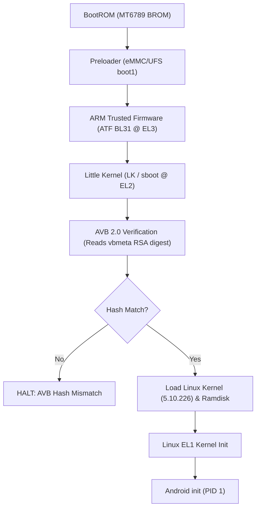
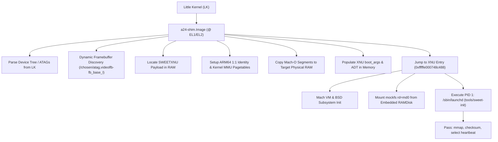

# Preflight Audit & Hardware Deployment Analysis: Apple XNU on Samsung Galaxy A24 (SM-A245F)

## 1. Executive Summary

- **Device**: Samsung Galaxy A24 (`SM-A245F`), MediaTek MT6789 (Helio G99).
- **Last recorded physical state**: USB-connected Download Mode (`ODIN MODE`); not checked during this handoff.
- **Scope of that earlier audit**: source review and offline artifacts only; no physical boot or partition write is documented. Device state has not been checked during this handoff.
- **Repository Branch at that earlier audit**: `a24-port`; see current status in `NOTES.md`.

This document serves as the formal preflight audit, cataloging all compiled artifacts, static verification results, Samsung Secure Boot limitations, and prerequisites required before any physical boot attempt can take place.

---

## 2. Inventory of Target Artifacts

The table below records the artifact inventory from an earlier preflight report. That directory is not present in the current checkout; see the newer handoff in `NOTES.md` for files currently available.

| Artifact | Size (Bytes) | Format | Entry / Load Address | SHA-256 | Purpose & Description |
|---|---|---|---|---|---|
| `kernel.development.a24` | 17,153,800 | Mach-O 64-bit arm64 | Entry: `0xfffffe000748c488` VA: `0xfffffe0006000000` | `5767afdfcf8c7b7b84a42b0150d3846343237089ee86a5c20956e4ead2d3ca25` | Historical CI-linked XNU build with `sweet_hfs`/`mockfs`; no MTK UFS driver or physical A24 storage operation is verified. |
| `out-a24.adt` | 9,412 | Apple Device Tree | Target Type: `D22AP` Candidate DRAM Base: `0x100000000` | `622ab0cf784563b1d662fc05314e0056d30634972cc495976d2e22a7c499da69` | ADT candidate with 13 MHz timebase and 8 CPUs. The physical usable-RAM map and bootloader reservations have not been validated for XNU handoff. |
| `a24-shim.elf` | 25,912 | ELF 64-bit aarch64 | Entry: `0x00000000` Relocations: 0 | `c8f4ca8c87608d117154e8de57a2f74c87ba0f47898c2834a89560cefc742ae2` | Unstripped freestanding bootstrap shim bootloader. |
| `a24-shim.Image` | 253,952 | Linux ARM64 Image | Header: `0x644d5241` (`ARMd`) Flags: `0xa` | `48d973a8251d212bef1e7cf4275a9aaf7757d6c2234ad1c757b6af9dcfc6ad20` | Flat binary kernel image with Linux ARM64 header for Little Kernel execution. Contains dynamic framebuffer locator. |
| `init` | 16,635 | Mach-O static arm64 | Entry: `0x100000400` Ad-hoc signed | `2733a87bfbfcb3bd9a365398b188910c0f4ce71f3b2531d66f6b4fa20cc109e0` | Static PID 1 userspace entry. Tests console, mmap (16K anon page), memory boundaries, checksum, and runs select heartbeat loop. |
| `a24-payload.bin` | 16,591,136 | SWEETXNU Container | Magic: `SWEETXNU` Ramdisk: `0x1024bc000` | `0b8554cb9e052855ac2777c5e14676e848cf0299eddafbfe88a35aa95a12a9a1` | Combined payload containing rebased XNU kernel segments, hardware ADT, embedded `init` ramdisk, and boot arguments. |
| `out-a24/a24-xnu-boot-current.img` | 16,850,944 | Android Boot v4 | Magic: `ANDROID!` Version: 4, 4096-pg | `450e334d8f70525d82cff7cbff0ecf3342059cb7124a5c31c161b9b3e945e342` | Refreshed offline packaging of the current shim and payload. Not tested on the A24. |
| `stock_boot.img` (historical reference) | 67,108,864 | Samsung Stock Boot | Kernel: `18,737,157` Magic: `SEANDROIDENFORCE` | `9ac63e6a612763a3190d7f2d23031fc311eefca22bd91d3e7feef5fa4e222e84` | Mentioned in an earlier report but absent from this checkout; a boot partition dump alone is not a complete recovery package. |

---

## 3. Analysis of Previous Bootloader & Odin Failures

An earlier handoff mentioned these errors, but no raw flashing log was preserved in this repository. Their precise context is unknown:

### 1. `SECURE CHECK FAIL: (vbmeta)` — root cause not established
- The repository has no preserved Odin/Heimdall log identifying the exact file, firmware build, PIT slot, and device state for this error. The cause therefore remains unverified.
- The previous claim that Download Mode universally requires Samsung's private RSA signature for every `vbmeta` image is not supported. Magisk's Samsung procedure says that after bootloader unlock, unofficial images are accepted, and documents patching the complete AP archive rather than treating a hand-made `vbmeta` as the universal method ([Magisk Samsung instructions](https://github.com/topjohnwu/Magisk/blob/master/docs/install.md#samsung-devices)).
- Do not infer that `avbtool --flags 3` itself caused the error, or that OEM unlock is ineffective. Check the exact transfer log, firmware binary revision, archive/member names, and Download Mode screen before diagnosing.

### 2. `SECURE CHECK FAIL: (boot)` — root cause not established
- The error alone does not prove a universal Samsung-signature gate. Magisk's Samsung path patches the device's matching full AP archive and flashes it with the corresponding firmware components after unlock. A standalone AOSP boot-v4 image is not equivalent to that packaging path.
- The earlier explanation involving Knox Guard, an RSA key in eFuse/RPMB, or an archive-layout fault was speculation; no captured log in this repository distinguishes those causes.

### 3. `AVB hash mismatch` - unverified report
- No raw Little Kernel log or exact firmware/image pair was preserved, so this cannot be attributed to this A24's unlocked boot state or to the current experimental image.
- AVB descriptors can reject changed partitions when verification is enforced. Whether and how this exact unlocked firmware handles the descriptor is not established here.

> [!IMPORTANT]
> The recorded Download Mode photo shows OEM Lock OFF and KG Completed, consistent with an unlocked device. Magisk documents that an unlocked Samsung accepts unofficial images. `WARRANTY VOID: 0x1` is a Knox warranty-state indicator, not evidence that Odin rejects every custom image. This does not establish that the project's current boot image is valid for this phone.

---

## 4. Boot Architecture Comparison

### A. Samsung Stock Boot Flow

### B. XNU Shim Boot Flow

---

## 5. Hardware vs QEMU Divergence Analysis

| Parameter | QEMU virt-8.2 Model | Physical MT6789 Hardware | Resolution in Codebase |
|---|---|---|---|
| **Timer Frequency** | 62.5 MHz (`CNTFRQ`) | **13.0 MHz** (`0xc65d40` / `clk13m`) | `A24_TIMEBASE = 13000000` hardcoded in `tools/mkadt.py`. |
| **Framebuffer Base** | Static RAMFB at `0x40000000` | Dynamic LK reservation (`0xfe144000` or `0x7e605000`) | Freestanding shim queries `/chosen/atag,videolfb-fb_base_l` dynamically. |
| **SMP PSCI Bootstrap** | Intercepted via `hvc #0` at EL2 (`Aff0` numbering `0..15`) | Requires `smc #0` to BL31 ATF at EL3 (`Aff1` cluster numbering `0x000..0x700`) | Confirmed XNU core numbering logic aligns with MT6789 Aff1; single-core (`cpus=1`) used for initial bringup to avoid EL3 traps. |
| **DRAM Address Base** | `0x40000000` | `0x100000000` (4 GiB PA boundary) | ADT `dram-base = 0x100000000`, kernel virt_base maps to `0x100000000`. |

---

## 6. Current Blockers & Prerequisites for Physical Boot

### Critical Blockers:
1. **Image acceptance and AVB behavior are unverified**: OEM Lock OFF changes the expected acceptance behavior, but the current AOSP-format image has not been tested on this firmware. Do not claim it will be rejected solely because it lacks a Samsung release signature.
2. **No physical boot has been attempted**: the report's proposed AVB failure is a hypothesis, not an observed result for this experimental image.

### Required Prerequisites Before First Physical Test:
1. **Use the documented unlocked Samsung image path as the baseline**:
   - Verify the exact model, current AP/BL revision, KG state, and full matching stock firmware. Magisk's Samsung instructions patch the matching AP archive and flash it with the corresponding firmware components; that documents a root-install path, not a validated XNU boot path.
2. **Do not treat `mtkclient` as an assumed bypass**:
   - Upstream `mtkclient` lists MT6789 under the V6 protocol and says a valid DA is required; it limits this path to unfused devices and states no public solution exists for devices with DAA/SLA/remote authentication enabled ([upstream README](https://github.com/bkerler/mtkclient)). It does not establish a safe `mtk boot`/DRAM-execution route for this Samsung.
3. **Treat kexec as an unverified research avenue, not a direct XNU launcher**:
   - `CONFIG_KEXEC`/`CONFIG_KEXEC_FILE` for this stock Samsung kernel have not been inspected. Linux kexec loads a Linux kernel image through Linux-specific handoff paths; the project's XNU transition still needs its custom shim and correct machine state. No A24 kexec path exists here.
4. **Safety Verification**:
   - Stock firmware restoration packages (`stock_boot.img`, `stock_repack_pass.tar`, `stock_restore.tar`) must remain verified and accessible to recover the device at any time.
